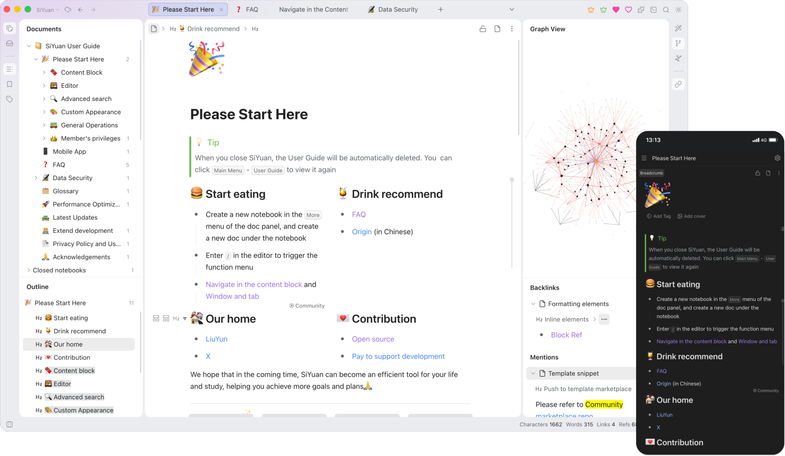
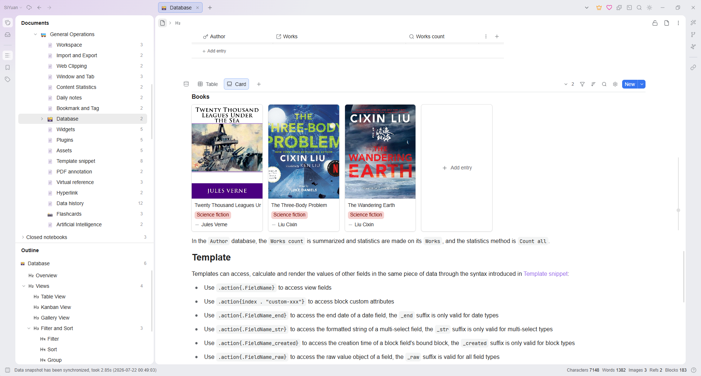
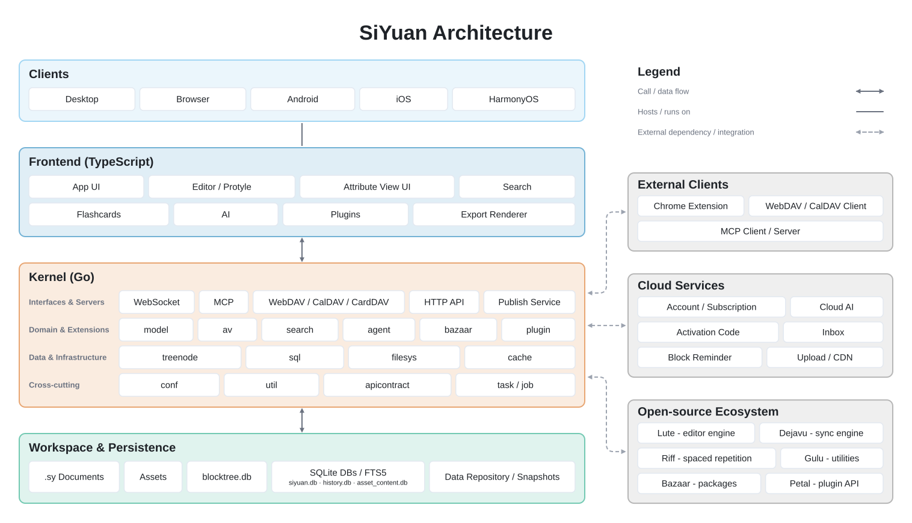

<p align="center">

<br>
<em>Do pensamento à descoberta, com agentes</em>
<br><br>
<a title="Status da compilação" target="_blank" href="https://github.com/siyuan-note/siyuan/actions/workflows/cd.yml"></a>
<a title="Versões" target="_blank" href="https://github.com/siyuan-note/siyuan/releases"></a>
<a title="Downloads" target="_blank" href="https://github.com/siyuan-note/siyuan/releases"></a>
<br>
<a title="Downloads da imagem Docker" target="_blank" href="https://hub.docker.com/r/b3log/siyuan"></a>
<a title="Tamanho da imagem Docker" target="_blank" href="https://hub.docker.com/r/b3log/siyuan"></a>
<a title="Acessos" target="_blank" href="https://github.com/siyuan-note/siyuan"></a>
<br>
<a title="AGPLv3" target="_blank" href="https://www.gnu.org/licenses/agpl-3.0.txt"></a>
<a title="Tamanho do código" target="_blank" href="https://github.com/siyuan-note/siyuan"></a>
<a title="Pull requests no GitHub" target="_blank" href="https://github.com/siyuan-note/siyuan/pulls"></a>
<br>
<a title="Commits no GitHub" target="_blank" href="https://github.com/siyuan-note/siyuan/commits/master"></a>
<a title="Último commit" target="_blank" href="https://github.com/siyuan-note/siyuan/commits/master"></a>
<br><br>
<a title="X" target="_blank" href="https://x.com/b3logos"></a>
<br><br>
<a href="https://trendshift.io/repositories/3949" target="_blank"></a>
</p>

<p align="center">
<a href="README.md">English</a>
| <a href="README.zh-CN.md">中文</a>
| <a href="README.ja.md">日本語</a>
| <a href="README.tr.md">Türkçe</a>
| <b>Português</b>
</p>

---

## Sumário

- [💡 Introdução](#-introdução)
- [🔮 Recursos](#-recursos)
- [🏗️ Arquitetura e ecossistema](#️-arquitetura-e-ecossistema)
- [🗺️ Roteiro](#️-roteiro)
- [🚀 Download e instalação](#-download-e-instalação)
  - [Lojas de aplicativos](#lojas-de-aplicativos)
  - [Pacotes de instalação](#pacotes-de-instalação)
  - [Gerenciadores de pacotes](#gerenciadores-de-pacotes)
  - [Hospedagem com Docker](#hospedagem-com-docker)
  - [Hospedagem com Kubernetes](#hospedagem-com-kubernetes)
  - [Hospedagem com Unraid](#hospedagem-com-unraid)
  - [Hospedagem com TrueNAS](#hospedagem-com-truenas)
  - [Canais de teste](#canais-de-teste)
- [⌨️ Interface de linha de comando](#️-interface-de-linha-de-comando)
- [🏘️ Comunidade](#️-comunidade)
- [🛠️ Guia de desenvolvimento](#️-guia-de-desenvolvimento)
- [❓ Perguntas frequentes](#-perguntas-frequentes)
  - [Como o SiYuan armazena os dados?](#como-o-siyuan-armazena-os-dados)
  - [Há suporte à sincronização de dados por serviços de sincronização de arquivos de terceiros?](#há-suporte-à-sincronização-de-dados-por-serviços-de-sincronização-de-arquivos-de-terceiros)
  - [O SiYuan é de código aberto?](#o-siyuan-é-de-código-aberto)
  - [Como atualizar para uma nova versão?](#como-atualizar-para-uma-nova-versão)
  - [O que fazer se o ícone de alguns blocos (como blocos de parágrafo em itens de lista) não aparecer?](#o-que-fazer-se-o-ícone-de-alguns-blocos-como-blocos-de-parágrafo-em-itens-de-lista-não-aparecer)
  - [O que devo fazer se perder a chave do repositório de dados?](#o-que-devo-fazer-se-perder-a-chave-do-repositório-de-dados)
  - [Preciso pagar para usar?](#preciso-pagar-para-usar)
- [🙏 Agradecimentos](#-agradecimentos)
  - [Colaboradores](#colaboradores)

---

## 💡 Introdução

O SiYuan é um sistema de gerenciamento de conhecimento pessoal que prioriza a privacidade, com suporte a referências em nível de bloco e edição Markdown WYSIWYG.





Para saber mais, leia o [guia do usuário online](https://siyuan-en.b3log.org/) ou participe do [fórum de discussão do SiYuan em inglês](https://liuyun.io).

## 🔮 Recursos

A maioria dos recursos é gratuita, inclusive para uso comercial.

- Bloco de conteúdo
  - Referências a blocos e links bidirecionais
  - Atributos personalizados
  - Incorporação de consultas SQL
  - Protocolo `siyuan://`
- Editor
  - Edição por blocos
  - Markdown WYSIWYG
  - Estrutura de tópicos em listas
  - Foco em um bloco
  - Edição de documentos extensos com milhões de palavras
  - Fórmulas matemáticas, gráficos, fluxogramas, gráficos de Gantt, diagramas de temporização, pautas musicais etc.
  - Captura de conteúdo da web
  - Links para anotações em PDF
- Exportação
  - Referências e incorporação de blocos
  - Markdown padrão com recursos
  - PDF, Word e HTML
  - Copiar para WeChat MP, Zhihu e Yuque
- Banco de dados
  - Visualização em tabela
- Repetição espaçada com cartões de estudo
- Escrita com IA e conversa de perguntas e respostas por meio da API da OpenAI
- OCR com Tesseract
- Múltiplas abas e divisão de tela por arrastar e soltar
- Trechos de modelos
- Trechos de JavaScript/CSS
- Aplicativos para Android/iOS/HarmonyOS
- Implantação com Docker
- [API](https://github.com/siyuan-note/siyuan/blob/master/docs/API.md)
- Loja da comunidade

Alguns recursos estão disponíveis apenas para usuários pagantes. Para mais detalhes, consulte os [preços](https://b3log.org/siyuan/en/pricing.html).

## 🏗️ Arquitetura e ecossistema



| Projeto | Descrição | Forks | Estrelas |
|---------|-----------|-------|----------|
| [lute](https://github.com/88250/lute) | Motor do editor |  |  |
| [chrome](https://github.com/siyuan-note/siyuan-chrome) | Extensão para Chrome/Edge |  |  |
| [bazaar](https://github.com/siyuan-note/bazaar) | Loja da comunidade |  |  |
| [dejavu](https://github.com/siyuan-note/dejavu) | Repositório de dados |  |  |
| [petal](https://github.com/siyuan-note/petal) | API de plugins |  |  |
| [android](https://github.com/siyuan-note/siyuan-android) | Aplicativo para Android |  |  |
| [ios](https://github.com/siyuan-note/siyuan-ios) | Aplicativo para iOS |  |  |
| [harmony](https://github.com/siyuan-note/siyuan-harmony) | Aplicativo para HarmonyOS |  |  |
| [riff](https://github.com/siyuan-note/riff) | Repetição espaçada |  |  |

## 🗺️ Roteiro

- [Plano de desenvolvimento e progresso do SiYuan](https://github.com/orgs/siyuan-note/projects/1)
- [Registro de alterações do SiYuan](CHANGELOG.md)

## 🚀 Download e instalação

Recomenda-se dar preferência à instalação pelas lojas de aplicativos em computadores e dispositivos móveis, para que seja possível atualizar a versão com um clique no futuro.

### Lojas de aplicativos

Dispositivos móveis:

- [App Store](https://apps.apple.com/us/app/siyuan/id1583226508)
- [Google Play](https://play.google.com/store/apps/details?id=org.b3log.siyuan)
- [F-Droid](https://f-droid.org/packages/org.b3log.siyuan)

Computadores:

- [Microsoft Store](https://apps.microsoft.com/detail/9p7hpmxp73k4)

### Pacotes de instalação

- [B3log](https://b3log.org/siyuan/en/download.html)
- [GitHub](https://github.com/siyuan-note/siyuan/releases)

### Gerenciadores de pacotes

#### `siyuan`

[](https://repology.org/project/siyuan/versions)

#### `siyuan-note`

[](https://repology.org/project/siyuan-note/versions)

### Hospedagem com Docker

<details>
<summary>Implantação com Docker</summary>

#### Visão geral

A forma mais simples de disponibilizar o SiYuan em um servidor é implantá-lo com Docker.

- Nome da imagem: `b3log/siyuan`
- [URL da imagem](https://hub.docker.com/r/b3log/siyuan)

#### Estrutura de arquivos

O programa fica em `/opt/siyuan/`, com uma estrutura que corresponde basicamente à pasta de recursos do pacote de instalação do Electron:

- appearance: ícones, temas e idiomas
- guide: documento do guia do usuário
- stage: interface e recursos estáticos
- kernel: programa do núcleo

#### Ponto de entrada

O ponto de entrada é definido durante a construção da imagem Docker: `ENTRYPOINT ["/opt/siyuan/entrypoint.sh"]`. Esse script permite alterar o `PUID` e o `PGID` do usuário usado dentro do contêiner. Isso é especialmente útil para resolver problemas de permissão ao montar diretórios do host. O `PUID` (ID do usuário) e o `PGID` (ID do grupo) podem ser passados como variáveis de ambiente, facilitando a configuração das permissões corretas de acesso aos diretórios montados do host.

Use os seguintes parâmetros ao executar o contêiner com `docker run b3log/siyuan`:

> **Observação:** Desde a versão v3.7.0, o subcomando `serve` deve ser passado explicitamente (por exemplo, `docker run b3log/siyuan serve --workspace=...`). Execute `docker run --rm b3log/siyuan serve --help` para ver todas as opções do servidor.

- `--workspace`: especifica o caminho da pasta do espaço de trabalho, montada no contêiner por meio de `-v` no host
- `--accessAuthCode`: especifica a senha da tela de bloqueio

Outros parâmetros podem ser consultados com `--help`. A seguir, um exemplo de comando de inicialização com as novas variáveis de ambiente:

Primeiro, defina `AuthCode` com uma senha forte de sua escolha (use `export AuthCode='your-strong-password'` no Bash; o Compose também pode ler um arquivo `.env` no mesmo diretório). O exemplo interrompe a execução com um erro se o valor não estiver definido ou estiver vazio.

```bash
docker run -d \
  -v workspace_dir_host:workspace_dir_container \
  -p 6806:6806 \
  -e PUID=1001 -e PGID=1002 \
  b3log/siyuan \
  serve \
  --workspace=workspace_dir_container \
  --accessAuthCode="${AuthCode:?Set AuthCode}"
```

- `PUID`: ID de usuário personalizado (opcional; o padrão é `1000` quando não informado)
- `PGID`: ID de grupo personalizado (opcional; o padrão é `1000` quando não informado)
- `workspace_dir_host`: caminho da pasta do espaço de trabalho no host
- `workspace_dir_container`: caminho da pasta do espaço de trabalho no contêiner, conforme especificado em `--workspace`
  - Como alternativa, é possível definir o caminho pela variável de ambiente `SIYUAN_WORKSPACE_PATH`. Se ambos estiverem definidos, a linha de comando sempre terá prioridade
- `accessAuthCode`: senha da tela de bloqueio (**não se esqueça de alterá-la**, caso contrário, qualquer pessoa poderá acessar seus dados)
  - Como alternativa, é possível definir a senha da tela de bloqueio pela variável de ambiente `SIYUAN_ACCESS_AUTH_CODE`. Se ambos estiverem definidos, a linha de comando sempre terá prioridade
  - Para desativar a senha da tela de bloqueio, defina a variável de ambiente `SIYUAN_ACCESS_AUTH_CODE_BYPASS=true`
- O OIDC pode substituir a senha da tela de bloqueio como autenticação de acesso obrigatória no Docker. Defina `SIYUAN_OIDC_ENABLED=true`, `SIYUAN_OIDC_PROVIDER` (`custom`, `google`, `microsoft` ou `github`), `SIYUAN_OIDC_CLIENT_ID` e os valores específicos do provedor descritos abaixo. O GitHub usa seu adaptador para a API de usuários OAuth 2.0; os demais provedores usam a descoberta OpenID Connect e a validação do ID Token. Uma configuração habilitada inválida interrompe a inicialização no Docker quando não há uma senha da tela de bloqueio disponível
  - `SIYUAN_OIDC_ISSUER_URL`: URL do emissor, obrigatória para os provedores `custom` e `microsoft`; no caso da Microsoft, deve ser usado um emissor específico do locatário, como `https://login.microsoftonline.com/<tenant-id>/v2.0`
  - `SIYUAN_OIDC_CLIENT_SECRET`: segredo do cliente opcional para provedores OpenID Connect; obrigatório para o adaptador OAuth do GitHub. Todo fluxo de código de autorização também usa PKCE
  - `SIYUAN_OIDC_SCOPES`: escopos separados por vírgulas ou espaços; `openid` é sempre incluído
  - `SIYUAN_OIDC_REDIRECT_URL`: URL HTTPS pública de retorno terminada em `/api/system/oidc/callback`, obrigatória para acesso remoto pelo navegador
  - `SIYUAN_OIDC_ALLOW_ALL`: concede explicitamente acesso de administrador do SiYuan a toda identidade autenticada pelo provedor
  - `SIYUAN_OIDC_CLAIM_RULES`: array JSON de regras de claims usado quando a permissão para todos está desativada, por exemplo, `[{"claim":"email","operator":"equals","values":["user@example.com"]},{"claim":"email_verified","operator":"equals","values":["true"]}]`; os valores dentro de uma regra usam OR, enquanto as regras usam AND
  - Os aplicativos móveis nativos usam a URI de retorno fixa `siyuan:/oidc-callback`; registre-a exatamente como está escrita. A verificação da configuração móvel usa esse retorno antes de salvar. Provedores personalizados, Microsoft e GitHub só podem ser usados quando o registro do aplicativo no provedor aceita essa URI de retorno. O Google não aceita essa URI de uso privado para seu tipo de cliente Android, por isso o login com Google fica limitado aos fluxos de navegador e desktop
- `SIYUAN_LANG`: idioma da interface (opcional; o padrão no Docker é `en` quando não definido). Aceita etiquetas BCP 47 como `zh-CN`/`zh-TW`/`en`/`ja`/`pt-BR`; valores legados com sublinhado, como `zh_CN`/`en_US`, também são aceitos para manter a compatibilidade. Omita a variável se quiser que o idioma escolhido em **Configurações** seja mantido após reinicializações; se definida, ela será aplicada em toda inicialização e substituirá a configuração salva
  - Como alternativa, use o parâmetro de linha de comando `--lang`. Se ambos estiverem definidos, a linha de comando terá prioridade

Para simplificar, recomenda-se configurar o mesmo caminho para a pasta do espaço de trabalho no host e no contêiner, por exemplo, definindo tanto `workspace_dir_host` quanto `workspace_dir_container` como `/siyuan/workspace`. O comando de inicialização correspondente seria:

Primeiro, defina `AuthCode` com uma senha forte de sua escolha (use `export AuthCode='your-strong-password'` no Bash; o Compose também pode ler um arquivo `.env` no mesmo diretório). O exemplo interrompe a execução com um erro se o valor não estiver definido ou estiver vazio.

```bash
docker run -d \
  -v /siyuan/workspace:/siyuan/workspace \
  -p 6806:6806 \
  -e PUID=1001 -e PGID=1002 \
  b3log/siyuan \
  serve \
  --workspace=/siyuan/workspace/ \
  --accessAuthCode="${AuthCode:?Set AuthCode}"
```

#### Docker Compose

Ao executar o SiYuan com Docker Compose, você pode passar as variáveis de ambiente `PUID` e `PGID` para personalizar os IDs de usuário e grupo. Veja um exemplo de configuração do Docker Compose:

Primeiro, defina `AuthCode` com uma senha forte de sua escolha (use `export AuthCode='your-strong-password'` no Bash; o Compose também pode ler um arquivo `.env` no mesmo diretório). O exemplo interrompe a execução com um erro se o valor não estiver definido ou estiver vazio.

```yaml
version: "3.9"
services:
  main:
    image: b3log/siyuan
    command: ['serve', '--workspace=/siyuan/workspace/', '--accessAuthCode=${AuthCode:?Set AuthCode}']
    ports:
      - 6806:6806
    volumes:
      - /siyuan/workspace:/siyuan/workspace
    restart: unless-stopped
    environment:
      - TZ=${YOUR_TIME_ZONE}    # A list of time zone identifiers can be found at https://en.wikipedia.org/wiki/List_of_tz_database_time_zones
      - PUID=${YOUR_USER_PUID}  # Customize user ID
      - PGID=${YOUR_USER_PGID}  # Customize group ID
```

Nessa configuração:

- `PUID` e `PGID` são definidos dinamicamente e passados ao contêiner
- Se essas variáveis não forem informadas, será usado o valor padrão `1000`

Ao especificar `PUID` e `PGID` no ambiente, você dispensa a definição explícita da diretiva `user` (`user: '1000:1000'`) no arquivo do Compose. O contêiner ajustará dinamicamente o usuário e o grupo com base nessas variáveis de ambiente durante a inicialização.

#### Permissões de usuário

Na imagem, o script `entrypoint.sh` garante a criação do usuário e do grupo `siyuan` com o `PUID` e o `PGID` especificados. Portanto, ao criar a pasta do espaço de trabalho no host, atribua a propriedade da pasta ao usuário e ao grupo correspondentes ao `PUID` e ao `PGID` que você pretende usar. Por exemplo:

```bash
chown -R 1001:1002 /siyuan/workspace
```

Se você usar valores personalizados para `PUID` e `PGID`, o script de ponto de entrada garantirá a criação do usuário e do grupo corretos dentro do contêiner, e a propriedade dos volumes montados será ajustada de acordo. Não é necessário passar `-u` manualmente em `docker run` ou `docker-compose`, pois as variáveis de ambiente cuidarão dessa personalização.

#### Ocultação da porta

Use um proxy reverso NGINX para ocultar a porta 6806. Observe os seguintes pontos:

- Configure o proxy reverso de WebSocket para `/ws`
- Preserve o cabeçalho `Host` original, incluindo a porta, tanto nas requisições comuns quanto em `/ws`. No NGINX, configure `proxy_set_header Host $http_host;` nos dois blocos `location` do proxy. O uso de `$host` remove portas não padrão (como `8443`), o que pode causar falha na validação de Origin, deixando a página parada no logotipo com recarregamentos repetidos, respostas `401` da API ou falhas nas conexões WebSocket

#### Observações

- Confirme se o volume foi montado corretamente; caso contrário, os dados serão perdidos após a exclusão do contêiner
- Não use reescrita de URL para redirecionamento, pois isso pode causar problemas de autenticação; recomenda-se configurar um proxy reverso
- Se encontrar problemas de permissão, verifique se as variáveis de ambiente `PUID` e `PGID` correspondem ao usuário e ao grupo proprietários dos diretórios montados no sistema host

#### Limitações

- Não oferece suporte a conexões de aplicativos desktop ou móveis; permite apenas o uso em navegadores
- Não oferece suporte à exportação para os formatos PDF, HTML e Word
- Não oferece suporte à importação de arquivos Markdown

</details>

### Hospedagem com Kubernetes

<details>
<summary>Implantação no Kubernetes</summary>

O [chart do SiYuan da HelmForge](https://github.com/helmforgedev/charts/tree/main/charts/siyuan) é mantido pela comunidade HelmForge, usa a imagem oficial `b3log/siyuan` e não é um chart oficial do SiYuan. Relate problemas com o chart à [HelmForge](https://github.com/helmforgedev/charts/issues).

Prepare o Helm, o kubectl e um cluster Kubernetes com uma StorageClass padrão capaz de provisionar um volume ReadWriteOnce de 10Gi e execute os seguintes comandos:

```bash
helm repo add helmforge https://repo.helmforge.dev
helm repo update
helm install siyuan helmforge/siyuan --namespace siyuan --create-namespace --wait
kubectl -n siyuan get secret siyuan-siyuan-auth -o go-template='{{index .data "access-code" | base64decode}}{{"\n"}}'
kubectl -n siyuan port-forward service/siyuan-siyuan 6806:6806
```

Abra <http://localhost:6806> e informe a senha da tela de bloqueio gerada. Guarde essa senha com segurança; ela é diferente do token da API. Os nomes acima pressupõem os valores padrão do chart e o nome de release `siyuan`.

Para acesso remoto, use um nome de host HTTPS dedicado e um controlador Ingress que encaminhe conexões WebSocket em `/ws`, sem reescrita de URL. Configure `ingress` e permita o namespace do controlador em `networkPolicy.ingressFrom`; a política padrão permite apenas tráfego de entrada do mesmo namespace e tráfego de saída para DNS. Adicione regras explícitas de saída para sincronização em nuvem ou outros serviços externos. Consulte o [guia do chart e o exemplo de produção](https://helmforge.dev/docs/charts/siyuan) para configurar TLS, Secrets existentes e armazenamento.

- **Um espaço de trabalho, um único processo de escrita:** Nunca aumente o número de réplicas nem monte o mesmo espaço de trabalho em outra instância em execução, mesmo com armazenamento ReadWriteMany. O chart usa `Recreate`, portanto as atualizações interrompem o processo de escrita antigo antes de iniciar o novo e causam indisponibilidade.
- **Persistência:** O espaço de trabalho completo é montado em `/siyuan/workspace`. Por padrão, o chart mantém o PVC gerado após a desinstalação; excluir o namespace ou o PVC ainda pode destruir os dados. Reutilize um PVC mantido ou restaurado com `persistence.existingClaim`.
- **Backups e atualizações:** Encerre normalmente o processo de escrita antes de fazer backup do espaço de trabalho completo ou use um procedimento de backup consistente com o estado da aplicação. Uma cópia apenas do índice SQLite em uso é insuficiente. Guarde com segurança os Secrets de autenticação, as chaves de criptografia e as senhas de recuperação dos cadernos criptografados e teste a restauração em um PVC separado. Faça backup antes das atualizações e verifique as alterações no formato de armazenamento: o rollback do Helm não desfaz migrações de dados.

As limitações da hospedagem com Docker também se aplicam: uso apenas pelo navegador, sem conexões dos aplicativos para computador ou dispositivos móveis, sem exportação para PDF/HTML/Word e sem importação de arquivos Markdown.

</details>

### Hospedagem com Unraid

<details>
<summary>Implantação no Unraid</summary>

Observação: primeiro, execute `chown -R 1000:1000 /mnt/user/appdata/siyuan` no terminal.

Modelo de referência:

```
Web UI: 6806
Container Port: 6806
Container Path: /siyuan/workspace
Host path: /mnt/user/appdata/siyuan
PUID: 1000
PGID: 1000
Publish parameters: serve --accessAuthCode=******(Lock screen password)
```

</details>

### Hospedagem com TrueNAS

<details>
<summary>Implantação no TrueNAS</summary>

Observação: primeiro, execute os comandos abaixo no Shell do TrueNAS. Substitua `Pool_1/Apps_Data/siyuan` pelo caminho do seu dataset.

```shell
zfs create Pool_1/Apps_Data/siyuan
chown -R 1001:1002 /mnt/Pool_1/Apps_Data/siyuan
chmod 755 /mnt/Pool_1/Apps_Data/siyuan
```

Acesse Apps - DiscoverApps - More Options (no canto superior direito, ao lado de Custom App) - Install via YAML.

Modelo de referência:

Antes de implantar, preencha uma senha forte de sua escolha após `SIYUAN_ACCESS_AUTH_CODE=` abaixo; não deixe esse valor vazio.

```yaml
services:
  siyuan:
    image: b3log/siyuan
    container_name: siyuan
    command: ['serve', '--workspace=/siyuan/workspace/']
    ports:
      - 6806:6806
    volumes:
      - /mnt/Pool_1/Apps_Data/siyuan:/siyuan/workspace  # Adjust to your dataset path
    restart: unless-stopped
    environment:
      - SIYUAN_ACCESS_AUTH_CODE=
      - TZ=America/New_York  # Replace with your timezone if needed
      - PUID=1001
      - PGID=1002
```

</details>

### Canais de teste

Selecione Beta ou Alpha em `Configurações - Sobre - Canal de atualização` para receber versões de pré-lançamento. Beta inclui versões estáveis, RC e Beta; Alpha inclui todas as versões. Os canais de teste exigem acesso ao GitHub.

## ⌨️ Interface de linha de comando

A CLI integrada oferece acesso direto aos dados do espaço de trabalho, sem necessidade de um servidor em execução.

A CLI não oferece suporte a operações em cadernos criptografados. Desbloqueie e acesse esses cadernos pelo fluxo específico no aplicativo.

### Início rápido

```bash
# List all notebooks
siyuan notebook list -w ~/SiYuan

# Full-text search with JSON output
siyuan search "keyword" -w ~/SiYuan -f json

# Search inside asset files (PDF/Word/Excel/txt etc.)
siyuan search "phrase" --asset -w ~/SiYuan
siyuan search "phrase" --asset --ext pdf --ext docx -w ~/SiYuan

# Export a document as Markdown
siyuan export md --id <block-id> -w ~/SiYuan
```

### Comandos disponíveis

| Categoria | Comandos |
|----------|----------|
| Cadernos e documentos | `notebook`, `document`, `dailynote` — CRUD e notas diárias |
| Conteúdo | `block`, `attr`, `outline` — leitura e escrita de blocos, atributos e estrutura |
| Metadados | `tag`, `bookmark`, `template` — etiquetas, marcadores e trechos de modelos |
| Consultas | `search`, `sql` — consultas de texto completo, semânticas, de conteúdo de recursos e SQL |
| Referências | `ref` — links de retorno e menções |
| Importação/Exportação | `export`, `import`, `inbox` — Markdown, HTML, pré-visualização, Word, .sy.zip, Data e caixa de entrada na nuvem |
| Gerenciamento de dados | `repo`, `history`, `sync` — instantâneos, versões e sincronização em nuvem |
| Utilitários | `asset`, `file` — recursos e sistema de arquivos |
| Banco de dados | `database` — gerenciamento de visualizações de atributos |
| Servidor | `serve` — inicia o servidor HTTP do kernel |
| Espaço de trabalho e sistema | `workspace`, `system` — listagem, inspeção e informações do sistema |

Execute `siyuan --help` para ver a árvore completa de comandos. Use `-f json` (o padrão é `-f table`) para obter uma saída adequada para scripts. A maioria dos comandos que modificam dados também oferece suporte a `--dry-run` para visualizar as alterações sem aplicá-las.

### Instalação

O executável da CLI é `<install-dir>/resources/kernel/SiYuan-Kernel`, chamado pelo comando `siyuan`.

- **Windows**: o instalador adiciona automaticamente o diretório do kernel ao `PATH`, portanto `siyuan` funciona sem configuração adicional. A edição da Microsoft Store (3.8.7+) registra o alias de execução de aplicativo `siyuan.exe` no Windows 10 1607 (compilação 14393) ou posterior. Após instalar ou atualizar, abra um novo terminal e execute `siyuan --help`
  ```powershell
  siyuan --help

  # Check which command is being used
  Get-Command siyuan -All
  where.exe siyuan
  ```
  Se o comando não estiver disponível, verifique se o alias de execução de aplicativo do SiYuan está habilitado no Windows e se `%LOCALAPPDATA%\Microsoft\WindowsApps` está no `PATH`. Os comandos acima mostram qual executável é encontrado; a presença de várias edições do SiYuan ou a ordem do `PATH` pode fazer com que outro executável seja selecionado

  Se você criou o antigo script intermediário `siyuan.cmd`, primeiro verifique o alias da Store diretamente com `& "$env:LOCALAPPDATA\Microsoft\WindowsApps\siyuan.exe" --help` e depois, se desejar, remova o script intermediário: `Remove-Item "$env:LOCALAPPDATA\Microsoft\WindowsApps\siyuan.cmd"`
- **macOS**: crie um link simbólico após a instalação:
  ```bash
  ln -s /Applications/SiYuan.app/Contents/Resources/kernel/SiYuan-Kernel /usr/local/bin/siyuan
  ```
- **Linux**: crie um link simbólico após a instalação:
  ```bash
  ln -s <install-dir>/resources/kernel/SiYuan-Kernel /usr/local/bin/siyuan
  ```

## 🏘️ Comunidade

- [Fórum de discussão em inglês](https://liuyun.io)
- [Visão geral da comunidade de usuários](https://liuyun.io/article/1687779743723)
- [Awesome SiYuan](https://github.com/siyuan-note/awesome)

## 🛠️ Guia de desenvolvimento

Consulte o [Guia de desenvolvimento](https://github.com/siyuan-note/siyuan/blob/master/.github/CONTRIBUTING.md).

## ❓ Perguntas frequentes

### Como o SiYuan armazena os dados?

Os dados são salvos na pasta de dados do espaço de trabalho:

- `assets` armazena todos os recursos inseridos
- `emojis` armazena imagens de emojis
- `snippets` armazena trechos de código
- `storage` armazena condições de consulta, layouts, cartões de estudo etc.
- `templates` armazena trechos de modelos
- `widgets` armazena widgets
- `plugins` armazena plugins
- `public` armazena dados públicos
- As pastas dos cadernos contêm os dados dos documentos. Cadernos comuns armazenam documentos `.sy` como JSON; cadernos criptografados os armazenam como texto cifrado.

### Há suporte à sincronização de dados por serviços de sincronização de arquivos de terceiros?

A sincronização de dados por serviços de sincronização de arquivos de terceiros não é suportada, pois pode corromper os dados.

Embora não ofereça suporte a esses serviços de sincronização de arquivos, o SiYuan permite a conexão com armazenamento em nuvem de terceiros (recurso disponível para usuários pagantes).

### O SiYuan é de código aberto?

O SiYuan é totalmente de código aberto, e contribuições são bem-vindas:

- [Interface do usuário e kernel](https://github.com/siyuan-note/siyuan)
- [Android](https://github.com/siyuan-note/siyuan-android)
- [iOS](https://github.com/siyuan-note/siyuan-ios)
- [HarmonyOS](https://github.com/siyuan-note/siyuan-harmony)
- [Extensão de captura para Chrome](https://github.com/siyuan-note/siyuan-chrome)

Para mais detalhes, consulte o [Guia de desenvolvimento](https://github.com/siyuan-note/siyuan/blob/master/.github/CONTRIBUTING.md).

### Como atualizar para uma nova versão?

- Se você instalou por uma loja de aplicativos, atualize pela própria loja
- Se você instalou com o pacote de instalação para computador no Windows ou macOS, pode habilitar a opção <kbd>Configurações</kbd> - <kbd>Sobre</kbd> - <kbd>Baixar automaticamente pacote de atualização</kbd>; assim, o SiYuan baixará automaticamente o pacote da versão mais recente e solicitará a instalação
- Se você fez a instalação manual com um pacote de instalação, baixe o pacote novamente para instalar

Você pode usar <kbd>Verificar atualização</kbd> em <kbd>Configurações</kbd> - <kbd>Sobre</kbd> - <kbd>Versão atual</kbd> ou acompanhar o [Download oficial](https://b3log.org/siyuan/en/download.html) ou as [Versões no GitHub](https://github.com/siyuan-note/siyuan/releases) para obter a nova versão.

**Observação:** Mantenha seu espaço de trabalho fora do diretório de instalação; a atualização do SiYuan limpa os arquivos desse diretório.

### O que fazer se o ícone de alguns blocos (como blocos de parágrafo em itens de lista) não aparecer?

O ícone de bloco é omitido no primeiro sub-bloco de um item de lista. Você pode mover o cursor para esse bloco e abrir seu menu com <kbd>Ctrl+/</kbd>.

### O que devo fazer se perder a chave do repositório de dados?

A chave do repositório de dados protege os instantâneos e os dados de sincronização. Ela é independente da senha mestra dos cadernos criptografados e dos backups das chaves. Redefinir o repositório de dados não recupera uma senha mestra perdida nem substitui os backups correspondentes das chaves de criptografia.

Antes de redefinir, encerre o SiYuan normalmente e faça backup do espaço de trabalho completo. Se você tiver cadernos criptografados, também mantenha backups separados e correspondentes das chaves de criptografia e confirme que a senha mestra funciona. Exclua diretórios antigos de sincronização em nuvem e instantâneos somente depois que a nova sincronização for concluída, os dados forem verificados e os materiais de recuperação estiverem guardados com segurança.

- Se a chave do repositório de dados foi inicializada corretamente em vários dispositivos anteriormente, ela é a mesma em todos eles e pode ser obtida em <kbd>Configurações</kbd> - <kbd>Conta e Sincronização</kbd> - <kbd>Repositório de dados</kbd> - <kbd>Chave do repositório de dados</kbd> - <kbd>Copiar string da chave</kbd>
- Se ela não foi configurada corretamente antes (por exemplo, as chaves em vários dispositivos são diferentes) ou se todos os dispositivos estão indisponíveis e não é possível obter a string da chave, você pode redefini-la seguindo estas etapas:

  1. Encerre o SiYuan normalmente e faça backup do espaço de trabalho completo; para cadernos criptografados, preserve também os backups correspondentes das chaves de criptografia e a senha mestra
  2. <kbd>Configurações</kbd> - <kbd>Conta e Sincronização</kbd> - <kbd>Repositório de dados</kbd> - <kbd>Chave do repositório de dados</kbd> - <kbd>Redefinir repositório de dados</kbd>
  3. Reinicialize a chave do repositório de dados. Depois de inicializá-la em um dispositivo, importe a chave nos outros dispositivos
  4. Use um novo diretório de sincronização em nuvem; exclua o diretório antigo somente depois que a nova sincronização for concluída, os dados forem verificados e os materiais de recuperação estiverem guardados com segurança
  5. Exclua os instantâneos antigos da nuvem somente depois que a nova sincronização for concluída, os dados forem verificados e os materiais de recuperação estiverem guardados com segurança

### Preciso pagar para usar?

A maioria dos recursos é gratuita, inclusive para uso comercial.

Os recursos exclusivos para membros exigem pagamento; consulte os [preços](https://b3log.org/siyuan/en/pricing.html).

## 🙏 Agradecimentos

O surgimento do SiYuan deve muito a diversos projetos de código aberto e colaboradores. Consulte kernel/go.mod e app/package.json no código-fonte do projeto e a página inicial do projeto.

O crescimento do SiYuan deve muito ao feedback e à divulgação dos usuários. Agradecemos a todos pela ajuda com o SiYuan ❤️

### Colaboradores

Junte-se a nós e contribua com código para o SiYuan.

<a href="https://github.com/siyuan-note/siyuan/graphs/contributors">
   
</a>
