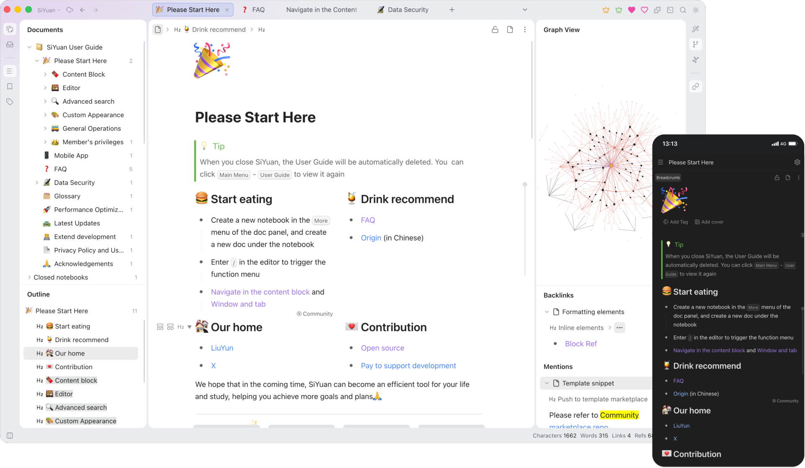
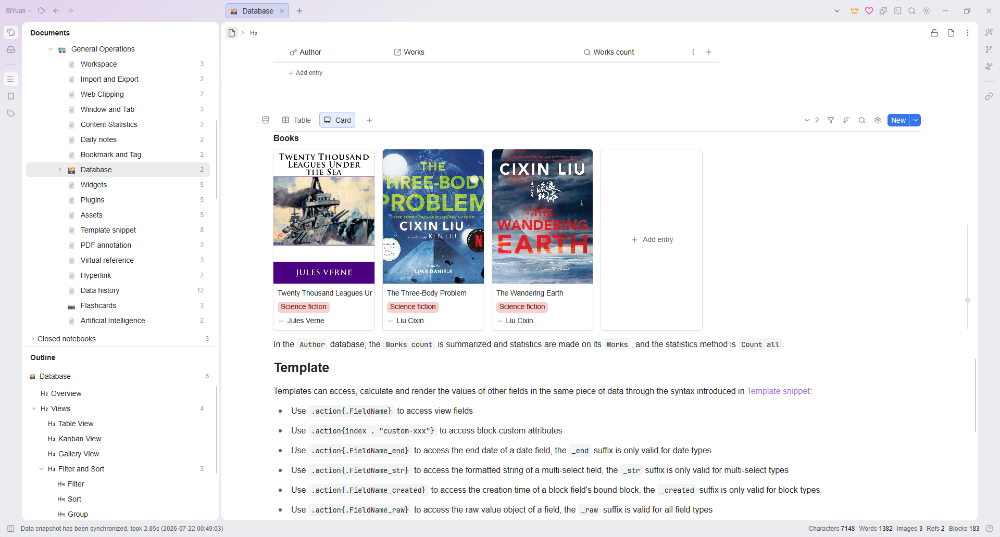
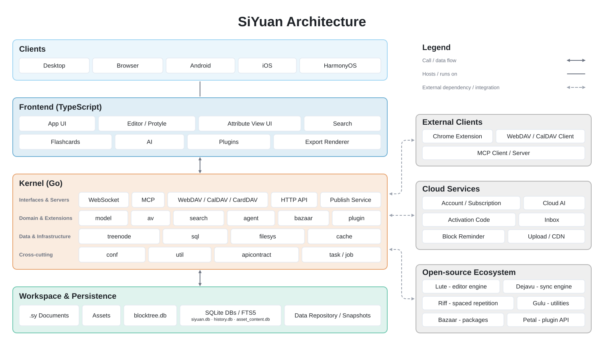

<p align="center">

<br>
<em>Từ suy nghĩ đến hiểu biết sâu sắc nhờ cách người dùng (agent)</em>
<br><br>
<a title="Build Status" target="_blank" href="https://github.com/siyuan-note/siyuan/actions/workflows/cd.yml"></a>
<a title="Releases" target="_blank" href="https://github.com/siyuan-note/siyuan/releases"></a>
<a title="Downloads" target="_blank" href="https://github.com/siyuan-note/siyuan/releases"></a>
<br>
<a title="Docker Pulls" target="_blank" href="https://hub.docker.com/r/b3log/siyuan"></a>
<a title="Docker Image Size" target="_blank" href="https://hub.docker.com/r/b3log/siyuan"></a>
<a title="Hits" target="_blank" href="https://github.com/siyuan-note/siyuan"></a>
<br>
<a title="AGPLv3" target="_blank" href="https://www.gnu.org/licenses/agpl-3.0.txt"></a>
<a title="Code Size" target="_blank" href="https://github.com/siyuan-note/siyuan"></a>
<a title="GitHub Pull Requests" target="_blank" href="https://github.com/siyuan-note/siyuan/pulls"></a>
<br>
<a title="GitHub Commits" target="_blank" href="https://github.com/siyuan-note/siyuan/commits/master"></a>
<a title="Last Commit" target="_blank" href="https://github.com/siyuan-note/siyuan/commits/master"></a>
<br><br>
<a title="X" target="_blank" href="https://x.com/b3logos"></a>
<br><br>
<a href="https://trendshift.io/repositories/3949" target="_blank"></a>
</p>

<p align="center">
<a href="README.md">English</a>
| <a href="README.zh-CN.md">中文</a>
| <a href="README.ja.md">日本語</a>
| <a href="README.tr.md">Türkçe</a>
| <a href="README.pt-BR.md">Português</a>
| <b>Tiếng Việt</b>
</p>

---

## Mục lục

- [💡 Giới thiệu](#-giới-thiệu)
- [🔮 Các tính năng](#-các-tính-năng)
- [🏗️ Kiến trúc và Hệ sinh thái](#️-kiến-trúc-và-hệ-sinh-thái)
- [🗺️ Lộ trình](#️-lộ-trình)
- [🚀 Tải xuống và cài đặt](#-tải-xuống-và-cài-đặt)
  - [Cửa hàng ứng dụng](#cửa-hàng-ứng-dụng)
  - [Gói cài đặt](#gói-cài-đặt)
  - [Trình quản lý gói](#trình-quản-lý-gói)
  - [Lưu trữ Docker](#lưu-trữ-docker)
  - [Lưu trữ Kubernetes](#lưu-trữ-kubernetes)
  - [Lưu trữ trên Unraid](#lưu-trữ-trên-unraid)
  - [Lưu trữ TrueNAS](#lưu-trữ-truenas)
  - [Các kênh thử nghiệm](#các-kênh-thử-nghiệm)
- [⌨️ Giao diện dòng lệnh](#️-giao-diện-dòng-lệnh)
- [🏘️ Cộng đồng](#️-cộng-đồng)
- [🛠️ Hướng dẫn phát triển](#️-hướng-dẫn-phát-triển)
- [❓ FAQ](#-faq)
  - [SiYuan lưu trữ dữ liệu như thế nào?](#siyuan-lưu-trữ-dữ-liệu-như-thế-nào)
  - [Nó có hỗ trợ đồng bộ hóa dữ liệu thông qua ổ đĩa đồng bộ của bên thứ ba không?](#nó-có-hỗ-trợ-đồng-bộ-hóa-dữ-liệu-thông-qua-ổ-đĩa-đồng-bộ-của-bên-thứ-ba-không)
  - [SiYuan có phải là mã nguồn mở không?](#siyuan-có-phải-là-mã-nguồn-mở-không)
  - [Làm thế nào để nâng cấp lên phiên bản mới?](#làm-thế-nào-để-nâng-cấp-lên-phiên-bản-mới)
  - [Điều gì sẽ xảy ra nếu một số khối (chẳng hạn như các khối đoạn văn nằm trong các mục danh sách) không tìm thấy biểu tượng khối?](#điều-gì-sẽ-xảy-ra-nếu-một-số-khối-chẳng-hạn-như-các-khối-đoạn-văn-nằm-trong-các-mục-danh-sách-không-tìm-thấy-biểu-tượng-khối)
  - [Tôi nên làm gì nếu khóa kho dữ liệu bị mất?](#tôi-nên-làm-gì-nếu-khóa-kho-dữ-liệu-bị-mất)
  - [Tôi có cần phải trả tiền cho việc đó không?](#tôi-có-cần-phải-trả-tiền-cho-việc-đó-không)
- [🙏 Lời cảm ơn](#-lời-cảm-ơn)
  - [Những người đóng góp](#những-người-đóng-góp)

---

## 💡 Giới thiệu

SiYuan là hệ thống quản lý tri thức cá nhân ưu tiên quyền riêng tư, hỗ trợ tham chiếu ở cấp độ khối (block-level) với độ chi tiết cao cùng định dạng Markdown theo kiểu WYSIWYG (những gì bạn thấy cũng là những gì bạn nhận được).





Để tìm hiểu thêm, hãy đọc [hướng dẫn sử dụng trực tuyến](https://siyuan-en.b3log.org/) hoặc tham gia [diễn đàn SiYuan tiếng Anh](https://liuyun.io).

## 🔮 Các tính năng

Hầu hết các tính năng đều miễn phí, ngay cả khi sử dụng cho mục đích thương mại.

- Khối nội dung (Content block)
  - Tham chiếu ở cấp độ khối (Block-level) và liên kết hai chiều
  - Các thuộc tính tùy chỉnh
  - Nhúng truy vấn SQL (SQL query embed)
  - Giao thức `siyuan://`
- Chỉnh sửa (Editor)
  - Kiểu khối (Block-style)
  - Markdown WYSIWYG
  - Dàn ý danh sách (List outline)
  - Tập trung vào khối
  - Chỉnh sửa tài liệu quy mô lớn với dung lượng lên đến hàng triệu từ
  - Các công thức toán học, biểu đồ, lưu đồ, biểu đồ Gantt, biểu đồ thời gian, khuông nhạc, v.v.
  - Lưu nội dung từ trang web
  - Liên kết chú thích PDF
- Xuất khẩu (Export)
  - Tham chiếu và nhúng khối
  - Markdown tiêu chuẩn kèm theo các tài nguyên
  - PDF, Word và HTML
  - Sao chép sang WeChat MP, Zhihu và Yuque
- Cơ sở dữ liệu (Database)
  - Chế độ xem dạng bảng (Table view)
- Lặp lại ngắt quãng với thẻ ghi nhớ (flashcard)
- Viết nội dung và trò chuyện hỏi đáp bằng AI thông qua OpenAI API
- Tesseract OCR
- Nhiều thẻ (Multi-tab), kéo thả để chia màn hình
- Đoạn mẫu (Template snippet)
- Đoạn mã JavaScript/CSS
- Ứng dụng Android, iOS và HarmonyOS
- Triển khai bằng Docker
- [API](https://github.com/siyuan-note/siyuan/blob/master/docs/API.md)
- Chợ cộng đồng (Community marketplace)

Một số tính năng chỉ dành cho thành viên trả phí; để biết thêm chi tiết, vui lòng tham khảo [Giá cả](https://b3log.org/siyuan/en/pricing.html).

## 🏗️ Kiến trúc và Hệ sinh thái



| Dự án | Mô tả | Fork | Sao |
| --- | --- | --- | --- |
| [lute](https://github.com/88250/lute)                    | Nhân xử lý trình chỉnh sửa         |                  |                  |
| [chrome](https://github.com/siyuan-note/siyuan-chrome)   | Tiện ích mở rộng Chrome/Edge |   |   |
| [bazaar](https://github.com/siyuan-note/bazaar)          | Chợ cộng đồng |          |          |
| [dejavu](https://github.com/siyuan-note/dejavu)          | Kho lưu trữ dữ liệu             |          |          |
| [petal](https://github.com/siyuan-note/petal)            | API dành cho plugin            |           |           |
| [android](https://github.com/siyuan-note/siyuan-android) | Ứng dụng Android           |  |  |
| [ios](https://github.com/siyuan-note/siyuan-ios)         | Ứng dụng iOS               |      |      |
| [harmony](https://github.com/siyuan-note/siyuan-harmony) | Ứng dụng HarmonyOS         |  |  |
| [riff](https://github.com/siyuan-note/riff)              | Lặp lại ngắt quãng     |            |            |

## 🗺️ Lộ trình

- [Kế hoạch và tiến độ phát triển SiYuan](https://github.com/orgs/siyuan-note/projects/1)
- [Nhật ký thay đổi SiYuan](CHANGELOG.md)

## 🚀 Tải xuống và cài đặt

Bạn nên ưu tiên cài đặt thông qua kho ứng dụng trên máy tính hoặc thiết bị di động, nhờ đó bạn có thể nâng cấp phiên bản chỉ với một cú nhấp chuột trong tương lai.

### Cửa hàng ứng dụng

Điện thoại:

- [App Store](https://apps.apple.com/us/app/siyuan/id1583226508)
- [Google Play](https://play.google.com/store/apps/details?id=org.b3log.siyuan)
- [F-Droid](https://f-droid.org/packages/org.b3log.siyuan)

Máy tính:

- [Microsoft Store](https://apps.microsoft.com/detail/9p7hpmxp73k4)

### Gói cài đặt

- [B3log](https://b3log.org/siyuan/en/download.html)
- [GitHub](https://github.com/siyuan-note/siyuan/releases)

### Trình quản lý gói

#### `siyuan`

[](https://repology.org/project/siyuan/versions)

#### `siyuan-note`

[](https://repology.org/project/siyuan-note/versions)

### Lưu trữ Docker

<details>
<summary>Triển khai bằng Docker</summary>

#### Tổng quan

Cách dễ nhất để chạy SiYuan trên máy chủ là triển khai nó thông qua Docker.

- Tên image `b3log/siyuan`
- [Image trên Docker Hub](https://hub.docker.com/r/b3log/siyuan)

#### Cấu trúc thư mục

Toàn bộ chương trình nằm tại thư mục `/opt/siyuan/`, về cơ bản có cấu trúc tương tự như thư mục `resources` trong gói cài đặt Electron:

- `appearance` chứa biểu tượng, chủ đề và gói ngôn ngữ
- `guide` chứa tài liệu hướng dẫn sử dụng
- `stage` chứa giao diện và tài nguyên tĩnh
- `kernel` chứa chương trình nhân

#### Điểm khởi chạy

Điểm khởi chạy (entry point) được thiết lập khi xây dựng image Docker: `ENTRYPOINT ["/opt/siyuan/entrypoint.sh"]`. Tập lệnh này cho phép thay đổi `PUID` (User ID) và `PGID` (Group ID) của người dùng sẽ thực thi bên trong container. Điều này đặc biệt hữu ích để giải quyết các vấn đề về quyền truy cập khi gắn (mount) các thư mục từ máy chủ (host). Bạn có thể truyền `PUID` (User ID) và `PGID` (Group ID) thông qua các biến môi trường, giúp đảm bảo quyền truy cập chính xác khi thao tác với các thư mục được gắn từ máy chủ.

Hãy sử dụng các tham số dưới đây khi chạy container với lệnh `docker run b3log/siyuan`:

> **Lưu ý** Kể từ v3.7.0, lệnh phụ `serve` phải được chỉ định rõ ràng (ví dụ `docker run b3log/siyuan serve --workspace=...`). Hãy chạy lệnh `docker run --rm b3log/siyuan serve --help` để xem tất cả các tùy chọn vận hành.

- `--workspace`: Chỉ định đường dẫn (path) thư mục không gian (workspace folder) làm việc, được gắn vào container thông qua tùy chọn `-v` trên máy chủ
- `--accessAuthCode`: Thiết lập mật khẩu màn hình khóa (lock screen password)

Bạn có thể tìm thấy thêm các tham số bằng cách sử dụng `--help`. Dưới đây là ví dụ về lệnh khởi chạy với các biến môi trường mới:

Trước tiên, hãy đặt `AuthCode` thành mật khẩu mạnh của riêng bạn (sử dụng `export AuthCode='your-strong-password'` trong Bash; Compose cũng có thể đọc tệp (file) `.env` nằm trong cùng thư mục (directory). Ví dụ này sẽ dừng lại kèm theo thông báo lỗi nếu giá trị đó không được thiết lập hoặc để trống.

```bash
docker run -d \
  -v workspace_dir_host:workspace_dir_container \
  -p 6806:6806 \
  -e PUID=1001 -e PGID=1002 \
  b3log/siyuan \
  serve \
  --workspace=workspace_dir_container \
  --accessAuthCode="${AuthCode:?Set AuthCode}"
```

- `PUID`: tùy chỉnh ID người dùng  (tùy chọn (optional); nếu không cung cấp, giá trị mặc định là `1000`)
- `PGID`: tùy chỉnh ID nhóm  (tùy chọn (optional); mặc định là `1000` nếu không được cung cấp)
- `workspace_dir_host`: Đường dẫn thư mục không gian làm việc trên máy chủ (The workspace folder path on the host)
- `workspace_dir_container`: Đường dẫn đến thư mục không gian (workspace folder) làm việc trong vùng chứa, như đã được chỉ định trong `--workspace`
  - Ngoài ra, bạn có thể thiết lập đường dẫn thông qua biến môi trường `SIYUAN_WORKSPACE_PATH` . Dòng lệnh sẽ luôn được ưu tiên nếu cả hai đều được thiết lập
- `accessAuthCode`: Mật khẩu màn hình khóa (Lock screen password) (vui lòng **nhớ thay đổi**, nếu không bất kỳ ai cũng có thể truy cập dữ liệu của bạn)
  - Ngoài ra, bạn có thể thiết lập mật khẩu màn hình khóa thông qua biến môi trường `SIYUAN_ACCESS_AUTH_CODE` . Dòng lệnh sẽ luôn được ưu tiên nếu cả hai đều được thiết lập
  - Để tắt mật khẩu màn hình khóa, hãy thiết lập biến môi trường (env variable) `SIYUAN_ACCESS_AUTH_CODE_BYPASS=true`
- OIDC có thể thay thế mật khẩu màn hình khóa làm phương thức xác thực bắt buộc để truy cập Docker. Hãy đặt `SIYUAN_OIDC_ENABLED=true`, `SIYUAN_OIDC_PROVIDER` (`custom`, `google`, `microsoft`, hoặc `github`), `SIYUAN_OIDC_CLIENT_ID`, và các giá trị dành riêng cho từng nhà cung cấp được liệt kê bên dưới. GitHub sử dụng bộ chuyển đổi API người dùng OAuth 2.0 của riêng mình; các nhà cung cấp khác sử dụng cơ chế khám phá OpenID Connect và xác thực ID Token. Nếu cấu hình được kích hoạt không hợp lệ và không có mật khẩu màn hình khóa, Docker sẽ không thể khởi động.
  - `SIYUAN_OIDC_ISSUER_URL`: URL của bên phát hành (Issuer URL) là bắt buộc đối với các nhà cung cấp `custom` và `microsoft`; Microsoft phải sử dụng một tổ chức phát hành dành riêng cho từng người thuê, chẳng hạn như `https://login.microsoftonline.com/<tenant-id>/v2.0`
  - `SIYUAN_OIDC_CLIENT_SECRET`: Mật mã khách hàng (client secret) tùy chọn dành cho các nhà cung cấp OpenID Connect; bắt buộc đối với bộ chuyển đổi OAuth của GitHub. Mọi quy trình cấp quyền theo mã (authorization-code flow) đều sử dụng thêm cơ chế PKCE.
  - `SIYUAN_OIDC_SCOPES`: Các phạm vi được phân tách bằng dấu phẩy hoặc khoảng trắng; `openid` luôn được bao gồm
  - `SIYUAN_OIDC_REDIRECT_URL`: URL callback HTTPS công khai kết thúc bằng `/api/system/oidc/callback`, bắt buộc để truy cập từ xa qua trình duyệt.
  - `SIYUAN_OIDC_ALLOW_ALL`: Cấp quyền quản trị viên trong SiYuan cho mọi danh tính được nhà cung cấp xác thực
  - `SIYUAN_OIDC_CLAIM_RULES`: Mảng JSON chứa các quy tắc xác nhận quyền (claim rules) được sử dụng khi tùy chọn "allow-all" bị vô hiệu hóa, chẳng hạn như `[{"claim":"email","operator":"equals","values":["user@example.com"]},{"claim":"email_verified","operator":"equals","values":["true"]}]`; các giá trị trong một quy tắc sử dụng toán tử OR, trong khi các quy tắc sử dụng toán tử AND
  - Các ứng dụng di động gốc (native mobile apps) sử dụng URI phản hồi (callback URI) cố định là `siyuan:/oidc-callback`; hãy đăng ký chính xác theo cách viết này. Quá trình xác minh cấu hình trên thiết bị di động sẽ sử dụng URI phản hồi này trước khi lưu thiết lập. Các nhà cung cấp tùy chỉnh, Microsoft và GitHub chỉ có thể được sử dụng khi việc đăng ký ứng dụng tại các nền tảng này chấp nhận URI phản hồi nêu trên. Google không chấp nhận URI dành cho mục đích sử dụng riêng (private-use URI) này đối với loại ứng dụng khách Android; do đó, tính năng đăng nhập bằng Google chỉ khả dụng thông qua trình duyệt hoặc các ứng dụng trên máy tính (desktop).
- `SIYUAN_LANG`: Ngôn ngữ giao diện (tùy chọn; mặc định là `en` nếu không được thiết lập trong Docker). Hỗ trợ các thẻ ngôn ngữ theo chuẩn BCP 47 như `zh-CN`/`zh-TW`/`en`/`ja`/`pt-BR`; các định dạng cũ sử dụng dấu gạch dưới như `zh_CN`/`en_US` cũng được chấp nhận để đảm bảo tính tương thích ngược. Hãy bỏ trống nếu bạn muốn ngôn ngữ đã chọn trong phần **Cài đặt** (Settings) được giữ nguyên sau mỗi lần khởi động lại; nếu được thiết lập, giá trị này sẽ được áp dụng mỗi khi khởi động và ghi đè lên cài đặt đã lưu trước đó.
  - Ngoài ra, bạn có thể sử dụng tham số dòng lệnh `--lang` . Nếu cả hai đều được thiết lập, tham số dòng lệnh sẽ được ưu tiên.

Để đơn giản hóa mọi thứ, nên cấu hình đường dẫn thư mục không gian (workspace folder) làm việc nhất quán trên máy chủ (host) và vùng chứa, ví dụ như cấu hình cả `workspace_dir_host` và `workspace_dir_container` là `/siyuan/workspace`. Lệnh khởi động tương ứng sẽ là:

Trước tiên, hãy đặt `AuthCode` thành mật khẩu mạnh của riêng bạn (sử dụng `export AuthCode='your-strong-password'` trong Bash; Compose cũng có thể đọc tệp (file) `.env` nằm trong cùng thư mục). Ví dụ này sẽ dừng lại kèm theo thông báo lỗi nếu giá trị đó không được thiết lập hoặc để trống.

```bash
docker run -d \
  -v /siyuan/workspace:/siyuan/workspace \
  -p 6806:6806 \
  -e PUID=1001 -e PGID=1002 \
  b3log/siyuan \
  serve \
  --workspace=/siyuan/workspace/ \
  --accessAuthCode="${AuthCode:?Set AuthCode}"
```

#### Docker Compose

Đối với người dùng chạy SiYuan bằng Docker Compose, bạn có thể truyền các biến môi trường `PUID` và `PGID` để tùy chỉnh ID người dùng (user ID) và ID nhóm (group ID). Dưới đây là ví dụ về cấu hình Docker Compose:

Trước tiên, hãy đặt `AuthCode` thành mật khẩu mạnh của riêng bạn (sử dụng `export AuthCode='your-strong-password'` trong Bash; Compose cũng có thể đọc tệp (file) `.env` nằm trong cùng thư mục). Ví dụ này sẽ dừng lại kèm theo thông báo lỗi nếu giá trị đó không được thiết lập hoặc để trống.

```yaml
version: "3.9"
services:
  main:
    image: b3log/siyuan
    command: ['serve', '--workspace=/siyuan/workspace/', '--accessAuthCode=${AuthCode:?Set AuthCode}']
    ports:
      - 6806:6806
    volumes:
      - /siyuan/workspace:/siyuan/workspace
    restart: unless-stopped
    environment:
      - TZ=${YOUR_TIME_ZONE}    # Danh sách múi giờ có tại https://en.wikipedia.org/wiki/List_of_tz_database_time_zones
      - PUID=${YOUR_USER_PUID}  # Đặt ID người dùng
      - PGID=${YOUR_USER_PGID}  # Đặt ID nhóm
```

Trong thiết lập này:

- `PUID` và `PGID` được thiết lập một cách linh hoạt và truyền vào container.
- Nếu các biến này không được cung cấp, giá trị mặc định là `1000` sẽ được sử dụng.

Bằng cách chỉ định `PUID` và `PGID` trong các biến môi trường, bạn không cần phải thiết lập tường minh chỉ thị `user` (`user: '1000:1000'`) trong tệp compose. Khi khởi chạy, container sẽ tự động điều chỉnh người dùng và nhóm dựa trên các biến môi trường này.

#### Quyền của người dùng (User Permissions)

Trong image này, tập lệnh (script) `entrypoint.sh` đảm bảo việc tạo người dùng (user) và nhóm (group) `siyuan` với các giá trị `PUID` và `PGID` được chỉ định. Do đó, khi tạo thư mục không gian làm việc (workspace folder) trên máy chủ (host), bạn cần lưu ý thiết lập quyền sở hữu thư mục đó cho đúng với `PUID` và `PGID` mà bạn dự định sử dụng. Ví dụ:

```bash
chown -R 1001:1002 /siyuan/workspace
```

Nếu bạn sử dụng các giá trị `PUID` và `PGID` tùy chỉnh, tập lệnh entrypoint sẽ đảm bảo rằng người dùng và nhóm (group) tương ứng được tạo bên trong container, đồng thời quyền sở hữu các volume được gắn (mounted volumes) cũng sẽ được điều chỉnh cho phù hợp. Bạn không cần phải truyền thủ công tham số `-u` trong lệnh `docker run` hoặc `docker-compose` vì các biến môi trường này sẽ tự động xử lý việc tùy chỉnh đó.

#### Cổng ẩn (Hidden port)

Sử dụng NGINX reverse proxy để ẩn cổng 6806. Xin lưu ý:

- Cấu hình proxy ngược WebSocket cho `/ws`
- Hãy giữ nguyên tiêu đề `Host` ban đầu (bao gồm cả cổng) cho cả các yêu cầu thông thường lẫn các yêu cầu `/ws`. Trong NGINX, hãy cấu hình `proxy_set_header Host $http_host;` tại cả hai vị trí proxy. Nếu sử dụng `$host`, các cổng không tiêu chuẩn (ví dụ: `8443`) sẽ bị loại bỏ; điều này có thể khiến quá trình xác thực  `Origin` thất bại, dẫn đến tình trạng trang web bị treo ở màn hình logo và liên tục tải lại, các phản hồi API trả về mã `401`, hoặc kết nối WebSocket bị lỗi.
- Hãy thiết lập `proxy_set_header X-Forwarded-For $remote_addr;` trong cả hai vị trí proxy để hệ thống nhận được địa chỉ thực của máy khách (client). Tuyệt đối không chuyển tiếp nguyên trạng tiêu đề `X-Forwarded-For` do phía gọi cung cấp, vì nếu làm vậy, một máy khách từ xa có thể bị hệ thống nhầm lẫn là quản trị viên cục bộ.

#### Lưu ý

- Hãy đảm bảo xác nhận tính chính xác của volume được gắn vào; nếu không, dữ liệu sẽ bị mất sau khi container bị xóa.
- Không nên sử dụng tính năng viết lại URL (URL rewriting) để thực hiện chuyển hướng, vì điều này có thể gây ra các vấn đề về xác thực; thay vào đó, bạn nên cấu hình một proxy ngược (reverse proxy).
- Nếu gặp vấn đề về quyền truy cập, hãy kiểm tra để đảm bảo rằng các biến môi trường `PUID` và `PGID` khớp với thông tin sở hữu của các thư mục được gắn (mount) trên hệ thống máy chủ của bạn.

#### Các hạn chế

- Không hỗ trợ kết nối qua ứng dụng trên máy tính và thiết bị di động, chỉ hỗ trợ sử dụng trên trình duyệt.
- Không hỗ trợ xuất sang các định dạng PDF, HTML và Word
- Không hỗ trợ nhập tệp Markdown

### Lưu trữ Kubernetes

<details>
<summary>Triển khai Kubernetes</summary>

Biểu đồ [HelmForge SiYuan](https://github.com/helmforgedev/charts/tree/main/charts/siyuan) được cộng đồng HelmForge duy trì và sử dụng image chính thức `b3log/siyuan`; đây không phải là biểu đồ chính thức từ phía SiYuan. Vui lòng báo cáo các vấn đề liên quan đến biểu đồ này cho [HelmForge](https://github.com/helmforgedev/charts/issues).

Hãy chuẩn bị Helm, kubectl và một cụm Kubernetes có StorageClass mặc định (có khả năng cấp phát volume 10Gi với chế độ ReadWriteOnce), sau đó chạy các lệnh sau:

```bash
helm repo add helmforge https://repo.helmforge.dev
helm repo update
helm install siyuan helmforge/siyuan --namespace siyuan --create-namespace --wait
kubectl -n siyuan get secret siyuan-siyuan-auth -o go-template='{{index .data "access-code" | base64decode}}{{"\n"}}'
kubectl -n siyuan port-forward service/siyuan-siyuan 6806:6806
```

Hãy mở [http://localhost:6806](http://localhost:6806) và nhập mật khẩu màn hình khóa đã được tạo. Hãy giữ mật khẩu này cẩn thận; nó khác với mã thông báo API (API token). Các tên gọi nêu trên giả định rằng các giá trị biểu đồ (chart values) và tên bản phát hành (release name) đều ở thiết lập mặc định là `siyuan`.

Để truy cập từ xa, hãy sử dụng một tên miền HTTPS chuyên dụng cùng với một Ingress controller có khả năng chuyển tiếp (proxy) các kết nối WebSocket tại đường dẫn `/ws` mà không thực hiện ghi đè URL (URL rewriting). Hãy cấu hình `ingress` và cho phép truy cập từ namespace của controller thông qua tham số `networkPolicy.ingressFrom`; chính sách mặc định chỉ cho phép lưu lượng truy cập nội bộ trong cùng namespace và lưu lượng truy cập ra ngoài (egress) tới DNS. Bạn cần bổ sung các quy tắc egress cụ thể nếu muốn kết nối với các dịch vụ đồng bộ trên nền tảng đám mây hoặc các dịch vụ bên ngoài khác. Vui lòng tham khảo [hướng dẫn về chart và ví dụ triển khai thực tế](https://helmforge.dev/docs/charts/siyuan) để biết thêm thông tin về cấu hình TLS, sử dụng các Secret có sẵn và thiết lập lưu trữ.

- **Một không gian làm việc, một trình ghi**: Không bao giờ mở rộng số lượng bản sao hoặc gắn cùng một không gian làm việc vào một phiên bản đang chạy khác, ngay cả với bộ nhớ ReadWriteMany. Biểu đồ sử dụng `Recreate`, vì vậy việc nâng cấp sẽ dừng trình ghi cũ trước khi khởi động trình ghi mới và gây ra thời gian ngừng hoạt động.
- **Tính bền vững (Persistence)**: Toàn bộ không gian làm việc được gắn (mount) tại `/siyuan/workspace`. Theo mặc định, PVC (Persistent Volume Claim) được tạo ra vẫn sẽ được giữ lại khi gỡ cài đặt; tuy nhiên, việc xóa namespace hoặc PVC vẫn có thể dẫn đến mất dữ liệu. Bạn có thể sử dụng lại một PVC đã được giữ lại hoặc khôi phục thông qua tùy chọn `persistence.existingClaim`.
- **Sao lưu và nâng cấp**: Hãy dừng tiến trình ghi (writer) một cách an toàn trước khi sao lưu toàn bộ không gian làm việc (workspace), hoặc sử dụng quy trình sao lưu đảm bảo tính nhất quán của ứng dụng (application-consistent backup). Chỉ sao chép tệp chỉ mục (index) SQLite đang hoạt động là không đủ. Hãy lưu trữ an toàn các thông tin xác thực (secrets), khóa mã hóa và mật khẩu khôi phục sổ tay (notebook) đã mã hóa; đồng thời, hãy kiểm thử quy trình khôi phục vào một PVC (Persistent Volume Claim) riêng biệt. Hãy thực hiện sao lưu trước khi nâng cấp và xem xét các thay đổi về định dạng lưu trữ: lệnh "Helm rollback" sẽ không hoàn tác các thay đổi đối với dữ liệu (data migrations).

Các hạn chế đối với dịch vụ lưu trữ Docker cũng được áp dụng: chỉ sử dụng qua trình duyệt, không hỗ trợ kết nối từ ứng dụng trên máy tính hoặc thiết bị di động, không cho phép xuất tệp định dạng PDF/HTML/Word, và không hỗ trợ nhập tệp Markdown.

</details>

### Lưu trữ trên Unraid

<details>
<summary>Triển khai Unraid</summary>

Lưu ý: Trước tiên, hãy chạy lệnh `chown -R 1000:1000 /mnt/user/appdata/siyuan` trong terminal.

Tham chiếu mẫu:

```
Web UI: 6806
Container Port: 6806
Container Path: /siyuan/workspace
Host path: /mnt/user/appdata/siyuan
PUID: 1000
PGID: 1000
Publish parameters: serve --accessAuthCode=******(Lock screen password)
```

</details>

### Lưu trữ TrueNAS

<details>
<summary>Triển khai TrueNAS</summary>

Lưu ý: Trước tiên, hãy chạy các lệnh dưới đây trong TrueNAS Shell. Vui lòng cập nhật `Pool_1/Apps_Data/siyuan` cho khớp với đường dẫn tập dữ liệu (dataset path) của bạn.

```shell
zfs create Pool_1/Apps_Data/siyuan
chown -R 1001:1002 /mnt/Pool_1/Apps_Data/siyuan
chmod 755 /mnt/Pool_1/Apps_Data/siyuan
```

Truy cập Apps - DiscoverApps - Các tùy chọn khác (ở phía trên bên phải, bên cạnh Custom App) - Cài đặt qua YAML

Tham chiếu mẫu:

Trước khi triển khai, hãy điền mật khẩu mạnh của riêng bạn vào sau phần `SIYUAN_ACCESS_AUTH_CODE=` bên dưới; đừng để trống.

```yaml
services:
  siyuan:
    image: b3log/siyuan
    container_name: siyuan
    command: ['serve', '--workspace=/siyuan/workspace/']
    ports:
      - 6806:6806
    volumes:
      - /mnt/Pool_1/Apps_Data/siyuan:/siyuan/workspace  # Đổi thành đường dẫn tập dữ liệu của bạn
    restart: unless-stopped
    environment:
      - SIYUAN_ACCESS_AUTH_CODE=
      - TZ=America/New_York  # Đổi thành múi giờ của bạn nếu cần
      - PUID=1001
      - PGID=1002
```

</details>

### Các kênh thử nghiệm

Chọn Beta hoặc Alpha trong mục `Cài đặt - Giới thiệu - Kênh cập nhật` (Settings - About - Update channel) để nhận các bản phát hành thử nghiệm. Kênh Beta bao gồm các bản phát hành ổn định (stable), bản ứng viên phát hành (RC) và bản Beta; kênh Alpha bao gồm tất cả các bản phát hành. Các kênh thử nghiệm yêu cầu quyền truy cập vào GitHub.

## ⌨️ Giao diện dòng lệnh

CLI tích hợp sẵn cho phép truy cập trực tiếp vào dữ liệu không gian làm việc — không yêu cầu phải chạy máy chủ.

CLI không hỗ trợ các thao tác trên các sổ ghi chép (notebook) đã mã hóa. Vui lòng mở khóa và truy cập chúng thông qua quy trình chuyên biệt ngay trong ứng dụng.

### Bắt đầu nhanh

```bash
# Liệt kê tất cả sổ tay
siyuan notebook list -w ~/SiYuan

# Tìm kiếm toàn văn và xuất kết quả JSON
siyuan search "keyword" -w ~/SiYuan -f json

# Tìm trong nội dung tài nguyên như PDF, Word, Excel và TXT
siyuan search "phrase" --asset -w ~/SiYuan
siyuan search "phrase" --asset --ext pdf --ext docx -w ~/SiYuan

# Xuất tài liệu dưới dạng Markdown
siyuan export md --id <block-id> -w ~/SiYuan
```

### Các lệnh khả dụng

| Nhóm | Lệnh |
| --- | --- |
| Sổ tay & Tài liệu (Notebooks & Documents) | `notebook`, `document`, `dailynote` — CRUD và ghi chú hàng ngày                      |
| Nội dung                                    | `block`, `attr`, `outline` — đọc/ghi khối, thuộc tính, dàn ý                     |
| Siêu dữ liệu (Metadata)                   | `tag`, `bookmark`, `template` — thẻ, dấu trang, các đoạn mã mẫu                   |
| Các truy vấn (Queries)                     | `search`, `sql` — tìm kiếm toàn văn, tìm kiếm ngữ nghĩa, tìm trong nội dung tài nguyên và truy vấn SQL                     |
| Tài liệu tham khảo (References)           | `ref` — các liên kết ngược và lượt đề cập                                         |
| Nhập khẩu/Xuất khẩu                      | `export`, `import`, `inbox` — Markdown, HTML, bản xem trước, Word, `.sy.zip`, dữ liệu và hộp thư đến đám mây |
| Quản lý dữ liệu                          | `repo`, `history`, `sync` — ảnh chụp nhanh, phiên bản, đồng bộ hóa đám mây    |
| Tiện ích                                   | `asset`, `file` — tài nguyên và hệ thống tệp                                        |
| Cơ sở dữ liệu (Database)                 | `database` — quản lý khung nhìn thuộc tính                  |
| Máy chủ (Server)                           | `serve` — khởi động máy chủ HTTP của nhân hệ thống  |
| Không gian làm việc & Hệ thống          | `workspace`, `system` — liệt kê, kiểm tra, thông tin hệ thống                        |

Hãy chạy `siyuan --help` để xem toàn bộ cây lệnh. Sử dụng tùy chọn `-f json` (mặc định là `-f table`) để nhận kết quả đầu ra ở định dạng phù hợp cho tập lệnh (script). Hầu hết các lệnh gây thay đổi dữ liệu cũng hỗ trợ tham số `--dry-run`, cho phép bạn xem trước các thay đổi mà không thực sự áp dụng chúng.

### Cài đặt

Tệp nhị phân CLI nằm tại `<install-dir>/resources/kernel/SiYuan-Kernel` và được gọi thông qua lệnh `siyuan`

- **Windows**: trình cài đặt sẽ tự động thêm thư mục chứa chương trình vào biến môi trường `PATH`, nhờ đó bạn có thể sử dụng `siyuan` ngay lập tức. Phiên bản trên Microsoft Store (từ bản 3.8.7 trở lên) sẽ đăng ký bí danh thực thi ứng dụng `siyuan.exe` trên Windows 10 phiên bản 1607 (build 14393) hoặc mới hơn. Sau khi cài đặt hoặc cập nhật, hãy mở một cửa sổ terminal mới và chạy lệnh `siyuan --help`.

  ```powershell
  siyuan --help

  # Kiểm tra lệnh nào đang được sử dụng
  Get-Command siyuan -All
  where.exe siyuan
  ```

  Nếu lệnh không khả dụng, hãy kiểm tra xem bí danh thực thi (execution alias) của ứng dụng SiYuan đã được bật trong Windows hay chưa, đồng thời đảm bảo rằng `%LOCALAPPDATA%\Microsoft\WindowsApps` đã có trong biến môi trường `PATH`. Các lệnh nêu trên minh họa quá trình xác định tệp thực thi; nếu bạn cài đặt nhiều phiên bản SiYuan hoặc do thứ tự trong `PATH`, hệ thống có thể chọn một tệp thực thi khác.

  Nếu bạn đã tạo tệp trung gian (shim) `siyuan.cmd` trước đây, trước tiên hãy kiểm tra bí danh từ Microsoft Store bằng lệnh `& "$env:LOCALAPPDATA\Microsoft\WindowsApps\siyuan.exe" --help`, sau đó bạn có thể xóa tệp trung gian này nếu muốn bằng lệnh: `Remove-Item "$env:LOCALAPPDATA\Microsoft\WindowsApps\siyuan.cmd"`
- **macOS**: tạo liên kết tượng trưng sau khi cài đặt:

  ```bash
  ln -s /Applications/SiYuan.app/Contents/Resources/kernel/SiYuan-Kernel /usr/local/bin/siyuan
  ```
- **Linux**: tạo liên kết tượng trưng sau khi cài đặt:

  ```bash
  ln -s <install-dir>/resources/kernel/SiYuan-Kernel /usr/local/bin/siyuan
  ```

## 🏘️ Cộng đồng

- [Diễn đàn thảo luận tiếng Anh](https://liuyun.io)
- [Tóm tắt từ cộng đồng người dùng](https://liuyun.io/article/1687779743723)
- [SiYuan tuyệt vời](https://github.com/siyuan-note/awesome)

## 🛠️ Hướng dẫn phát triển

Xem [Hướng dẫn phát triển](https://github.com/siyuan-note/siyuan/blob/master/.github/CONTRIBUTING.md).

## ❓ FAQ

### SiYuan lưu trữ dữ liệu như thế nào?

Dữ liệu được lưu trong thư mục dữ liệu của không gian làm việc:

- `assets` được sử dụng để lưu tất cả các tài nguyên đã chèn
- `emojis` được sử dụng để lưu các hình ảnh biểu tượng cảm xúc
- `snippets` được sử dụng để lưu các đoạn mã
- `storage` được sử dụng để lưu các điều kiện truy vấn, bố cục, thẻ ghi nhớ, v.v.
- `templates` được sử dụng để lưu các đoạn mẫu
- `widgets` được sử dụng để lưu các tiện ích
- `plugins` được sử dụng để lưu các plugin
- `public` được sử dụng để lưu trữ dữ liệu công khai
- Các thư mục sổ tay (Notebook folders) chứa dữ liệu tài liệu. Các sổ tay (Notebook) thông thường lưu trữ tài liệu `.sy` dưới dạng JSON; các sổ tay (Notebook) được mã hóa lưu trữ chúng dưới dạng văn bản mã hóa (ciphertext).

### Nó có hỗ trợ đồng bộ hóa dữ liệu thông qua ổ đĩa đồng bộ của bên thứ ba không?

Việc đồng bộ hóa dữ liệu thông qua các ổ đĩa đồng bộ của bên thứ ba không được hỗ trợ; nếu thực hiện, dữ liệu có thể bị hỏng.

Mặc dù không hỗ trợ các ổ đĩa đồng bộ của bên thứ ba, nhưng tính năng này cho phép kết nối với các dịch vụ lưu trữ đám mây của bên thứ ba (dành cho thành viên).

### SiYuan có phải là mã nguồn mở không?

SiYuan hoàn toàn là mã nguồn mở và luôn hoan nghênh các đóng góp:

- [Giao diện người dùng và hạt nhân](https://github.com/siyuan-note/siyuan)
- [Android](https://github.com/siyuan-note/siyuan-android)
- [iOS](https://github.com/siyuan-note/siyuan-ios)
- [HarmonyOS](https://github.com/siyuan-note/siyuan-harmony)
- [Tiện ích lưu nội dung web cho Chrome](https://github.com/siyuan-note/siyuan-chrome)

Để biết thêm chi tiết, vui lòng tham khảo [Hướng dẫn phát triển](https://github.com/siyuan-note/siyuan/blob/master/.github/CONTRIBUTING.md).

### Làm thế nào để nâng cấp lên phiên bản mới?

- Nếu đã cài đặt thông qua cửa hàng ứng dụng, vui lòng cập nhật thông qua cửa hàng ứng dụng đó.
- Nếu bạn cài đặt ứng dụng bằng gói cài đặt dành cho máy tính trên Windows hoặc macOS, bạn có thể bật tùy chọn <kbd>Cài đặt</kbd> (Settings) - <kbd>Giới thiệu</kbd> (About) - <kbd>Tự động tải xuống gói cài đặt cập nhật</kbd> (Automatically download update installation package). Khi đó, SiYuan sẽ tự động tải xuống gói cài đặt của phiên bản mới nhất và hiển thị thông báo nhắc bạn thực hiện cài đặt.
- Nếu phần mềm được cài đặt thông qua gói cài đặt thủ công, vui lòng tải xuống lại gói cài đặt đó để thực hiện cài đặt.

Bạn có thể chọn <kbd>Kiểm tra cập nhật</kbd> (Check update) trong mục <kbd>Cài đặt</kbd> (Settings) - <kbd>Giới thiệu</kbd> (About) - <kbd>Phiên bản hiện tại</kbd> (Current Version), hoặc theo dõi [Trang tải xuống chính thức](https://b3log.org/siyuan/en/download.html) hay [GitHub Releases](https://github.com/siyuan-note/siyuan/releases) để nhận phiên bản mới.

**Lưu ý**: Hãy đặt không gian làm việc của bạn bên ngoài thư mục cài đặt; việc cập nhật SiYuan sẽ xóa các tệp tin nằm trong thư mục cài đặt.

### Điều gì sẽ xảy ra nếu một số khối (chẳng hạn như các khối đoạn văn nằm trong các mục danh sách) không tìm thấy biểu tượng khối?

Biểu tượng khối sẽ không hiển thị đối với khối con đầu tiên nằm trong một mục danh sách. Bạn có thể di chuyển con trỏ vào khối này và mở menu khối bằng tổ hợp phím <kbd>Ctrl+/</kbd>.

### Tôi nên làm gì nếu khóa kho dữ liệu bị mất?

Khóa kho lưu trữ dữ liệu (data repo key) bảo vệ các bản chụp nhanh (snapshot) và dữ liệu đồng bộ. Khóa này tách biệt với mật khẩu chính của sổ ghi chép được mã hóa cũng như các bản sao lưu khóa. Việc thiết lập lại kho lưu trữ dữ liệu không thể giúp khôi phục mật khẩu chính đã mất, cũng không thể thay thế các bản sao lưu khóa mã hóa tương ứng.

Trước khi thực hiện thiết lập lại, hãy thoát SiYuan theo cách thông thường và sao lưu toàn bộ không gian làm việc (workspace). Nếu bạn có các sổ ghi chép (notebook) được mã hóa, hãy đảm bảo lưu giữ riêng các bản sao lưu khóa mã hóa tương ứng và xác nhận rằng mật khẩu chính (master password) vẫn hoạt động bình thường. Chỉ xóa các thư mục đồng bộ hóa đám mây cũ và các bản chụp nhanh (snapshot) sau khi quá trình đồng bộ hóa mới đã hoàn tất, dữ liệu đã được xác minh và các tài liệu phục hồi đã được lưu trữ an toàn.

- Nếu khóa kho dữ liệu (data repo key) đã được khởi tạo chính xác trên nhiều thiết bị trước đó, thì khóa này sẽ giống nhau trên tất cả các thiết bị và có thể được truy xuất tại mục <kbd>Cài đặt</kbd> - <kbd>Tài khoản & Đồng bộ</kbd> - <kbd>Kho lưu trữ dữ liệu</kbd> - <kbd>Khóa kho dữ liệu</kbd> - <kbd>Sao chép chuỗi khóa</kbd>
- Nếu trước đó cấu hình không chính xác (ví dụ: các khóa trên nhiều thiết bị không đồng nhất) hoặc tất cả các thiết bị đều không khả dụng và không thể lấy được chuỗi khóa, bạn có thể đặt lại khóa bằng cách thực hiện các bước dưới đây:

  1. Thoát SiYuan theo cách thông thường và sao lưu toàn bộ không gian làm việc; đối với các sổ ghi chép được mã hóa, hãy đảm bảo lưu giữ cả các bản sao lưu khóa mã hóa tương ứng cùng với mật khẩu chính.
  2. Chọn <kbd>Cài đặt</kbd> - <kbd>Tài khoản & Đồng bộ</kbd> - <kbd>Kho lưu trữ dữ liệu</kbd> - <kbd>Khóa kho dữ liệu</kbd> - <kbd>Đặt lại kho dữ liệu</kbd>.
  3. Khởi tạo lại khóa kho dữ liệu. Sau khi khởi tạo khóa trên một thiết bị, các thiết bị khác sẽ nhập khóa đó vào.
  4. Hãy sử dụng một thư mục đồng bộ hóa đám mây mới; chỉ xóa thư mục cũ sau khi quá trình đồng bộ hóa mới hoàn tất, dữ liệu đã được xác minh và các tài liệu phục hồi đã được lưu giữ an toàn.
  5. Chỉ xóa các bản chụp nhanh cũ trên đám mây sau khi đã đồng bộ xong, xác minh dữ liệu và lưu giữ an toàn thông tin khôi phục

### Tôi có cần phải trả tiền cho việc đó không?

Hầu hết các tính năng đều miễn phí, ngay cả khi sử dụng cho mục đích thương mại.

Các đặc quyền dành cho thành viên chỉ có thể được sử dụng sau khi đã thanh toán; vui lòng tham khảo mục [Giá cả](https://b3log.org/siyuan/en/pricing.html).

## 🙏 Lời cảm ơn

Sự ra đời của SiYuan gắn liền với nhiều dự án mã nguồn mở và các cá nhân đóng góp. Vui lòng tham khảo tệp `kernel/go.mod`, `app/package.json` trong mã nguồn dự án cũng như trang chủ của dự án.

Sự phát triển của SiYuan gắn liền với những phản hồi và sự quảng bá từ người dùng. Cảm ơn tất cả mọi người đã hỗ trợ SiYuan ❤️

### Những người đóng góp

Chào mừng bạn tham gia cùng chúng tôi và đóng góp mã nguồn cho SiYuan.

<a href="https://github.com/siyuan-note/siyuan/graphs/contributors">
   
</a>
